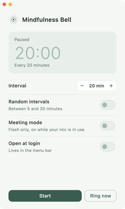

# Mindfulness Bell

A quiet mindfulness bell for the macOS menu bar. At your chosen interval it rings a bell and washes the screen in a soft sage light, then fades away.



## Features

- **Menu bar app**: a ripple icon shows time to the next bell, with Start/Pause, Ring now and Open at login. No Dock icon.
- **Intervals**: a fixed interval (1–180 minutes) or random between 5 and 30 minutes. Settings persist.
- **Gentle flash**: a full-screen color wash on every display, including over full-screen apps. It never takes clicks or focus, and it needs no special permissions.
- **Meeting mode**: flash only, no sound. Turns on by itself while any app is using your mic.
- **Open at login**: resumes the bell quietly in the menu bar if it was running when you quit.

## Installation

### Option 1: Download the pre-built app

1. Download the latest release from the [Releases](https://github.com/brentbaum/mindfulness_bell/releases) page
2. Unzip the file
3. Right-click (or Control+click) on `Mindfulness Bell.app` and select "Open"
4. Click "Open" in the security dialog that appears

### Option 2: Build from source

```bash
# Clone the repository
git clone https://github.com/brentbaum/mindfulness_bell.git
cd mindfulness_bell

# Install dependencies and run
flutter pub get
flutter run -d macos
```

## Development

```bash
mise run build    # release build, signed with your Apple Development certificate
mise run install  # build, then replace /Applications/Mindfulness Bell.app and launch
mise run icon     # re-render the icon set from tool/render_icon.swift
mise run release  # build, tag and publish a GitHub release (not notarized)
```

Design tokens live in `lib/ui.dart` (Stillwater palette). The native side (menu bar, flash overlay, mic monitor, launch at login) is in `macos/Runner/`, and the method channel contract is in `lib/native_bridge.dart`.

## License

MIT License
